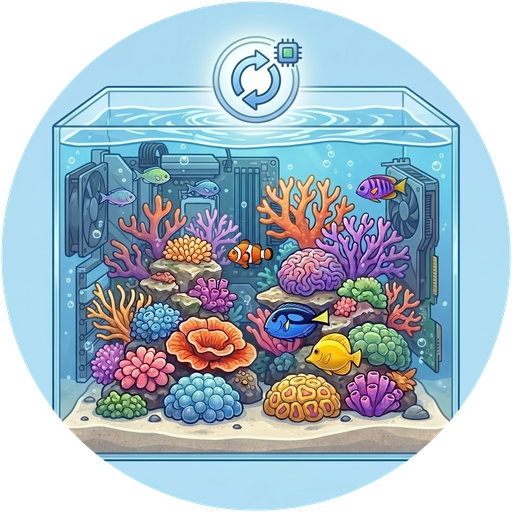

# ReefTank 🐟
> Teil des [**ReefTech-Projekt-Ökosystems**](https://elwinmage.github.io/reeftank/)
<p align="center">
  
</p>

[](https://github.com/hacs/default)
[](https://developers.home-assistant.io/docs/architecture_index/#branding)
[](https://github.com/Elwinmage/ha-reeftank-component/releases)

[](https://github.com/Elwinmage/ha-reeftank-component/actions/workflows/main.yml)
[](https://github.com/Elwinmage/ha-reeftank-component/actions/workflows/hass_and_hacs.yml)
[](https://app.codecov.io/gh/Elwinmage/ha-reeftank-component)
[](https://github.com/Elwinmage/ha-reeftank-component/commits/main)
[](https://github.com/MShawon/github-clone-count-badge)
[](https://opensource.org/licenses/MIT)
[](https://github.com/Elwinmage/ha-reeftank-component)
[](https://paypal.me/Elwinmage)

# Unterstützte Sprachen: [](https://github.com/Elwinmage/ha-reeftank-component/blob/main/README.md) [](https://github.com/Elwinmage/ha-reeftank-component/blob/main/doc/fr/README.fr.md)  [](https://github.com/Elwinmage/ha-reeftank-component/blob/main/doc/es/README.es.md) [](https://github.com/Elwinmage/ha-reeftank-component/blob/main/doc/it/README.it.md) [](https://github.com/Elwinmage/ha-reeftank-component/blob/main/doc/nl/README.nl.md) [](https://github.com/Elwinmage/ha-reeftank-component/blob/main/doc/pl/README.pl.md) [](https://github.com/Elwinmage/ha-reeftank-component/blob/main/doc/pt/README.pt.md)

Home-Assistant-Integration hinter der **Aquariumkarte** von [ha-reef-card](https://github.com/Elwinmage/ha-reef-card): ein lebendiges Bild Ihres Beckens, beleuchtet von Ihren echten Lampen, bevölkert von animierten Fischen und Korallen, mit Ihren Geräten und Entitäten darauf.

Sie speichert die Aquarien, ihre Bilder und ihren Besatz, protokolliert die Fütterungen und hält den Artenkatalog aktuell. Nichts Herstellerspezifisches: sie funktioniert mit Red Sea, Aqua Medic oder jedem anderen Gerät, das Home Assistant kennt.

<p align="center">
  
</p>

<!-- ecosystem:start -->

## Verwandte Projekte

Die ReefTech-Projekte greifen ineinander: die Integrationen bringen Ihre Geräte in Home Assistant, die Karte zeigt und steuert sie, und das Backup hält sie bei einem Stromausfall am Laufen. Jedes funktioniert auch für sich allein.

<p align="center"><a href="https://elwinmage.github.io/reeftank/"></a></p>

<table>
  <tr>
    <th width="100px"></th>
    <th>Projekt</th>
    <th>Funktion</th>
    <th>Arbeitet mit</th>
  </tr>
  <tr>
    <td></td>
    <td>🐠<br /><a href="https://github.com/Elwinmage/ha-reefbeat-component"><b>ha-reefbeat-component</b></a></td>
    <td>Red Sea ReefBeat-Geräte, lokal gesteuert ohne Cloud: ReefATO+, ReefControl, ReefControl-Power, ReefDose, ReefLed, ReefMat, ReefRun und ReefWave.<br />Alarm-Blueprint für abweichende Modi, Kalibrierungen und niedrigen Akkustand. <a href="https://my.home-assistant.io/redirect/blueprint_import/?blueprint_url=https://raw.githubusercontent.com/Elwinmage/ha-reefbeat-component/refs/heads/main/blueprints/automation/redsea_alerts.en.yaml"></a></td>
    <td>ha-reef-card</td>
  </tr>
  <tr>
    <td></td>
    <td>🌊<br /><a href="https://github.com/Elwinmage/ha-aquamedic-component"><b>ha-aquamedic-component</b></a></td>
    <td>Aqua Medic-Pumpen über die Gizwits-Cloud-API: EcoDrift- und SmartDrift-Strömungspumpen, DC Runner Rückförder- und Abschäumerpumpen.</td>
    <td>ha-reef-card</td>
  </tr>
  <tr>
    <td></td>
    <td>🐙<br /><a href="https://github.com/Elwinmage/ha-reef-maintenance-component"><b>ha-reef-maintenance-component</b></a></td>
    <td>Reinigungs- und Verschleißverfolgung für Geräte, die Home Assistant nicht erreicht: Strömungspumpen, Rückförderpumpen, Abschäumer, Reaktoren, alles was von Hand gewartet wird.</td>
    <td>ha-reef-card</td>
  </tr>
  <tr>
    <td></td>
    <td>🪸<br /><a href="https://github.com/Elwinmage/ha-reef-card"><b>ha-reef-card</b></a></td>
    <td>Interaktive grafische Ansicht jedes Geräts auf Ihrem Dashboard und der einzige Weg, erweiterte Zeitpläne zu bearbeiten. Liest die drei Integrationen über den gemeinsamen <code>reef_role</code>-Vertrag, ohne Konfiguration auf Kartenseite. Zeichnet außerdem die Energieflüsse von reefbeatEnergyBackup. Ihre Aquariumkarte erweckt Ihr Becken mit ha-reeftank-component zum Leben.</td>
    <td>alle drei Integrationen und ha-reeftank-component für das Aquarium</td>
  </tr>
  <tr>
    <td></td>
    <td>🐟<br /><b>ha-reeftank-component</b><br /><i>(dieses Repository)</i></td>
    <td>Ein lebendiges Bild Ihres Beckens auf dem Dashboard: Ihr Foto, beleuchtet von Ihren echten Lampen, mit animierten Fischen und Korallen und Ihren Geräten und Entitäten darauf. Speichert die Aquarien und ihren Besatz, protokolliert die Fütterungen.</td>
    <td>ha-reef-card</td>
  </tr>
  <tr>
    <td></td>
    <td>🐡<br /><a href="https://github.com/Elwinmage/reeftank-catalog"><b>reeftank-catalog</b></a></td>
    <td>Fische, Korallen und Texturen der Aquariumkarte, von ha-reeftank-component heruntergeladen und aktuell gehalten.</td>
    <td>ha-reeftank-component</td>
  </tr>
  <tr>
    <td></td>
    <td>🐬<br /><a href="https://github.com/Elwinmage/ha-reef-blueprints"><b>ha-reef-blueprints</b></a></td>
    <td>Automatisierungs-Blueprints für das gesamte Ökosystem: überfällige Wartungen, über den <code>reef_role</code>-Vertrag gefunden, nicht mehr erreichbare Geräte, ein regelmäßiger Heizertest und eine Relaisüberwachung. Acht Sprachen.</td>
    <td>alle drei Integrationen</td>
  </tr>
  <tr>
    <td></td>
    <td>⚡<br /><a href="https://github.com/Elwinmage/reefbeatEnergyBackup"><b>reefbeatEnergyBackup</b></a></td>
    <td>Batterie-Backup bei Stromausfall. Ein 24V LiFePO₄-Pack, gesteuert von einem Raspberry Pi, mit schrittweiser Reduzierung der Pumpendrehzahl je nach Ladezustand.</td>
    <td>eigenständig oder zusammen mit ha-reefbeat-component und ha-reef-card</td>
  </tr>
</table>

Alle zusammen sind auf der [ReefTech-Projektseite](https://elwinmage.github.io/reeftank/) dokumentiert.

<!-- ecosystem:end -->

## Funktionen

- **Ihr Foto, lebendig**: Wasser auf einem Foto Ihres Beckens umranden, die Karte animiert es
- **Echtes Licht**: das Wasser nimmt Farbe und Intensität Ihrer Lampen an (ReefLED oder jede `light`), nachts abgedunkelt, aber gut erkennbar
- **Fische und Korallen** aus dem [ReefTank-Katalog](https://github.com/Elwinmage/reeftank-catalog): Schwärme, Freiwasserschwimmer, Bodenbewohner, Grundeln, die aus ihrer Höhle schauen, Korallen, die sich mit den Pumpen wiegen
- **Tiefe**: Fische schwimmen hinter den umrandeten Steinen und ruhen nachts auf dem Sand
- **Gezeichnetes Becken**: kein schönes Foto vom Wasser? Zeichnen Sie es (Wasser, Sand, Gesteinstexturen) und behalten Sie den Rest des Fotos
- **Geräte und Entitäten** als Miniaturen auf dem Bild abgelegt oder darauf umrandet, anklickbar; Zonen, die ein anderes Bild öffnen (das Technikbecken im Schrank)
- **Fütterung**: Futterautomaten, Red-Sea-Kurzbefehle oder ein Dienst protokollieren jede Fütterung; die Fische eilen zur Futterstelle
- **Bestand**: Anzahl der Fische und Korallen als Sensoren, mit Verlauf

## Installation

### Direkte Installation

Klicken Sie hier, um das Repository direkt im Marketplace zu öffnen, und klicken Sie auf „Installieren“: [](https://my.home-assistant.io/redirect/hacs_repository/?owner=Elwinmage&repository=ha-reeftank-component&category=integration)

### Suche im Marketplace

Oder suchen Sie in *Einstellungen > Marketplace* nach „ReefTank“. Bei einem Home Assistant vor 2026.11 funktionieren dieselben Schritte in HACS.

Fügen Sie dann die Integration hinzu (ein Eintrag, nichts zu konfigurieren; mit HACS auf einem älteren Home Assistant zuerst neu starten): [](https://my.home-assistant.io/redirect/config_flow_start/?domain=reeftank)

Die Aquariumkarte selbst kommt mit [ha-reef-card](https://github.com/Elwinmage/ha-reef-card), ebenfalls zu installieren.

## Erste Schritte

1. Fügen Sie einem Dashboard eine **Reef Aquarium Card** hinzu (`custom:reef-aquarium-card`).
2. Legen Sie in ihrem Editor ein Aquarium an (**Neues Aquarium**), dann **Szene bearbeiten**.
3. **Ansichten**: ein Foto Ihres Beckens hochladen, das Wasser umranden, Sandlinie und Steine nachzeichnen.
4. **Geräte** und **Licht & Strömung**: Geräte und Entitäten auf das Bild ziehen, Lampen platzieren.
5. **Besatz**: Fische und Korallen hinzufügen, dann speichern.

Die Kartenkonfiguration enthält nur die Aquarium-ID; alles andere speichert die Integration:

```yaml
type: custom:reef-aquarium-card
aquarium: a1b2        # set by the card editor
view: front           # optional
render: static        # optional: static, light or full
```

## Der Szeneneditor

Ein Vollbilddialog, aus dem Karteneditor geöffnet, mit sieben Reitern:

| Reiter | Was man dort macht |
|---|---|
| **Aquarium** | Name, Maße, das passende Cloud-Aquarium, Licht, unter dem die Fotos entstanden, Darstellungsstufe, Dunkelheit des Wassers nachts |
| **Ansichten** | Bilder; für jedes Wasser: Umriss, Sandlinie (vorne und hinten), Steine mit ihrer Tiefe, anklickbare Zonen, gezeichneter Hintergrund und seine Texturen |
| **Geräte** | Ihre Geräte und Entitäten nach Etage und Bereich, auf das Bild gezogen |
| **Licht & Strömung** | Lampen, die jedes Wasser beleuchten, und ihre Position; Pumpen, die das Wasser bewegen |
| **Besatz** | Fische (Art, Anzahl, Größe, Revier) und Korallen (Art, Größe, Farben, Position) |
| **Fütterung** | Entitäten, die eine Fütterung protokollieren, und wo das Futter fällt |
| **Überwachung** | Die Entitäten für pH, ORP, CO2 im Raum und KH-Tests, was eine Kalibrierung anzeigt, die Alarmschwellen und der Status der Überwachung |

## Darstellungsstufen

Jedes Aquarium wird in einer von drei Stufen dargestellt; eine Karte kann sie senken, z. B. auf einem langsamen Wandtablet:

| Stufe | Zeigt |
|---|---|
| **Statisch** (`static`) | Bild, Geräte und Entitäten |
| **Licht** (`light`) | plus die Farbe der Lampen |
| **Voll** (`full`) | plus Fische und Korallen |

Ein Foto des Technikraums mit live angezeigten Geräten ist ein vollwertiges `static`-Aquarium.

## Wasserüberwachung

ReefTank vergleicht Ihr Becken mit seinem eigenen jüngsten Verlauf statt mit allgemeinen Grenzwerten und löst Alarme aus, wenn es davon abweicht. pH und ORP können von jeder numerischen Entität stammen; ein CO2-Sensor im Raum ist optional. Der pH misst nicht die KH: Diese Alarme sagen Ihnen, wann ein Test fällig ist.

| Alarm | Löst aus, wenn |
|---|---|
| **pH unter dem üblichen Niveau** | Das 24-h-Mittel liegt 0,1 unter dem Median der letzten 14 Tage. Mit CO2-Sensor zeigt `cause`, ob das CO2 im Raum dies erklärt |
| **pH-Schwankung größer als üblich** | Die 24-h-Amplitude übersteigt die übliche um 50 % |
| **pH-Tagesverlauf gestört** | Die letzten 4 Stunden weichen von der üblichen Tagesform ab |
| **ORP unter dem üblichen Niveau** | Der ORP ohne pH-Effekt bleibt 12 Stunden lang 30 mV unter seinem Median |
| **Verdächtige Sonde** | 12 Stunden eingefrorener Wert, 2 Stunden kein Wert, wiederholte Spitzen, ein Sprung, oder pH und ORP bewegen sich 2 Tage nicht mehr gemeinsam |
| **KH ändert sich zu schnell** | Zwei aufeinanderfolgende KH-Tests weichen um mehr als 0,5 dKH ab |

Die Alarme bleiben in den ersten 14 Tagen unbekannt, während das Becken gelernt wird; nur die verdächtige Sonde funktioniert von Anfang an. Alle Schwellen sind einstellbar.

Wählen Sie die Entitäten einmalig. Dieser Dienst setzt auch die Schwellen:

```yaml
action: reeftank.monitoring_configure
data:
  aquarium: Reefer 425
  ph_entity: sensor.tank_ph
  orp_entity: sensor.tank_orp
  co2_entity: sensor.room_co2
  kh_entity: sensor.reefdose_head_2_last_measurement
  ph_calibration_entity: sensor.tank_ph_last_adjustment
  orp_calibration_entity: sensor.tank_orp_last_adjustment
```

Mit einer KH-Test-Entität (z. B. der letzten Messung eines ReefDose-Kopfes) unterscheidet ein aktueller Test einen echten KH-Rückgang von einem CO2-Effekt oder einem Sondenproblem (`cause`) und liefert mit dem CO2 eine geschätzte KH zwischen zwei Tests.

Mit einer Kalibrierentität (dem letzten Justierdatum der Sonde) ist bei einer Kalibrierung nichts zu tun: Die Messwerte darum herum werden verworfen, und der Verlauf folgt nach 24 Stunden dem neuen Niveau. Schalten Sie für eine Reinigung oder einen Wasserwechsel den Pausenschalter ein: Er schaltet sich nach 6 Stunden selbst aus.

## Entitäten

Jedes Aquarium ist ein Gerät mit:

| Entität | Zustand |
|---|---|
| `sensor.<aquarium>_fish` | Anzahl der Fische, pro Art in den Attributen |
| `sensor.<aquarium>_corals` | Anzahl der Korallen, pro Art in den Attributen |
| `event.<aquarium>_feeding` | Letzte Fütterung, mit Art (Futterautomat, Kurzbefehl, manuell) und Quelle |
| `sensor.<aquarium>_feedings_today` | Fütterungen seit Mitternacht |
| `sensor.<aquarium>_water_monitoring` | Status der Überwachung, Lernfortschritt in den Attributen |
| `sensor.<aquarium>_ph_24_h_mean`, `sensor.<aquarium>_ph_swing_24_h` | 24-h-Mittel und -Amplitude des pH |
| `sensor.<aquarium>_orp_without_the_ph_effect` | ORP ohne den täglichen pH-Effekt |
| `sensor.<aquarium>_kh_estimated` | Geschätzte KH zwischen zwei Tests (braucht einen Test und das CO2) |
| `binary_sensor.<aquarium>_*` | Die sechs Alarme oben |
| `switch.<aquarium>_pause_monitoring` | Setzt die Analyse aus |
| `sensor.<aquarium>_water_volume` | Netto-Wasservolumen (L), von der ReefDose-Dosierregelung der redsea-Integration gelesen |

Und das Gerät *ReefTank catalog*:

| Entität | Zustand |
|---|---|
| `update.reeftank_catalog` | Installierte und neueste Katalogversion |
| `button.reeftank_catalog_check_for_updates` | Prüft sofort, ob eine neue Version vorliegt |

## Dienste

| Dienst | Wirkung |
|---|---|
| `reeftank.feed` | Protokolliert eine Fütterung (Futterautomaten außerhalb von Home Assistant, Skripte) |
| `reeftank.livestock_add` | Fügt dem Bestand Tiere hinzu |
| `reeftank.livestock_remove` | Entfernt Tiere (Verluste, Abgabe) |
| `reeftank.monitoring_configure` | Wählt die überwachten Entitäten und die Schwellen |
| `reeftank.monitoring_reset` | Verwirft den Verlauf, um neu zu lernen (neue Sonde) |

`aquarium` ist Name, ID oder Geräte-ID des Aquariums.

```yaml
action: reeftank.livestock_add
data:
  aquarium: Reefer 425
  species: chromis_viridis
  count: 3
```

## Artenkatalog

Fische, Korallen und Texturen stammen aus dem [ReefTank-Katalog](https://github.com/Elwinmage/reeftank-catalog), beim ersten Start heruntergeladen (github.com muss einmal erreichbar sein) und dann aktuell gehalten:

- eine neue Version wird automatisch installiert; *Einstellungen → Geräte & Dienste → ReefTank → Konfigurieren* schaltet das ab;
- `button.reeftank_catalog_check_for_updates` prüft sofort, statt auf die nächste Prüfung (alle 12 Stunden) zu warten;
- nur Geändertes wird heruntergeladen, und ein abgebrochenes Update lässt den bisherigen Katalog unangetastet.

Eigene Arten gehören nach `<config>/reeftank/catalog/` (gleicher Aufbau wie der Katalog): sie erscheinen ohne Neustart im Editor.

## Technische Referenz

Datenmodell, WebSocket-API, Render-Pipeline, Fischverhalten, Sprite-Format und Katalog-Updates: [technische Referenz](../../doc/en/technical.md) (auf Englisch).

## Entwicklung

Die Tests decken die Integration vollständig ab, und die CI sorgt dafür, dass es so bleibt. `scripts/gen_readme.py` erzeugt diese Seite und ihre sieben Übersetzungen: dort ändern, nicht in den erzeugten Dateien.

```bash
pip install -r requirements.test.txt
pytest -q --cov=custom_components.reeftank --cov-config=.coveragerc
ruff check . && ruff format --check .
pyright --project pyrightconfig.json
python3 scripts/check_translation.py
python3 scripts/gen_readme.py
```
