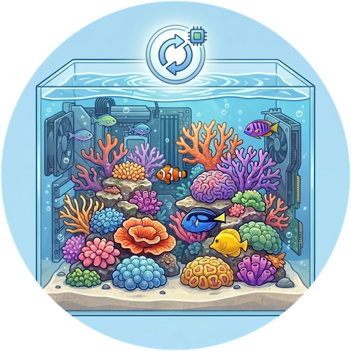

# ReefTank 🐟
> Fait partie de l'[**écosystème ReefTech**](https://elwinmage.github.io/reeftank/)
<p align="center">
  
</p>

[](https://github.com/hacs/default)
[](https://developers.home-assistant.io/docs/architecture_index/#branding)
[](https://github.com/Elwinmage/ha-reeftank-component/releases)

[](https://github.com/Elwinmage/ha-reeftank-component/actions/workflows/main.yml)
[](https://github.com/Elwinmage/ha-reeftank-component/actions/workflows/hass_and_hacs.yml)
[](https://app.codecov.io/gh/Elwinmage/ha-reeftank-component)
[](https://github.com/Elwinmage/ha-reeftank-component/commits/main)
[](https://github.com/MShawon/github-clone-count-badge)
[](https://opensource.org/licenses/MIT)
[](https://github.com/Elwinmage/ha-reeftank-component)
[](https://paypal.me/Elwinmage)

# Langues disponibles: [](https://github.com/Elwinmage/ha-reeftank-component/blob/main/README.md)  [](https://github.com/Elwinmage/ha-reeftank-component/blob/main/doc/de/README.de.md) [](https://github.com/Elwinmage/ha-reeftank-component/blob/main/doc/es/README.es.md) [](https://github.com/Elwinmage/ha-reeftank-component/blob/main/doc/it/README.it.md) [](https://github.com/Elwinmage/ha-reeftank-component/blob/main/doc/nl/README.nl.md) [](https://github.com/Elwinmage/ha-reeftank-component/blob/main/doc/pl/README.pl.md) [](https://github.com/Elwinmage/ha-reeftank-component/blob/main/doc/pt/README.pt.md)

Intégration Home Assistant derrière la **carte aquarium** de [ha-reef-card](https://github.com/Elwinmage/ha-reef-card) : une image vivante de votre bac, éclairée par vos vraies lampes, peuplée de poissons et de coraux animés, et portant vos appareils et vos entités.

Elle stocke les aquariums, leurs images et leur population, enregistre les nourrissages et tient le catalogue d'espèces à jour. Rien de propre à une marque : elle fonctionne avec Red Sea, Aqua Medic ou tout autre matériel connu de Home Assistant.

<p align="center">
  
</p>

La carte aquarium en action :

[](https://www.youtube.com/watch?v=ZtYobmQZf9k)

<!-- ecosystem:start -->

## Projets liés

Les projets ReefTech s'articulent entre eux : les intégrations font entrer votre matériel dans Home Assistant, la carte l'affiche et le pilote, et le secours le maintient en marche pendant une coupure. Chacun fonctionne aussi seul.

<p align="center"><a href="https://elwinmage.github.io/reeftank/"></a></p>

<table>
  <tr>
    <th width="100px"></th>
    <th>Projet</th>
    <th>Rôle</th>
    <th>Fonctionne avec</th>
  </tr>
  <tr>
    <td></td>
    <td>🐠<br /><a href="https://github.com/Elwinmage/ha-reefbeat-component"><b>ha-reefbeat-component</b></a></td>
    <td>Appareils Red Sea ReefBeat, pilotés en local sans cloud : ReefATO+, ReefControl, ReefControl-Power, ReefDose, ReefLed, ReefMat, ReefRun et ReefWave.<br />blueprint d'alertes pour les modes anormaux, les calibrations et les batteries faibles. <a href="https://my.home-assistant.io/redirect/blueprint_import/?blueprint_url=https://raw.githubusercontent.com/Elwinmage/ha-reefbeat-component/refs/heads/main/blueprints/automation/redsea_alerts.en.yaml"></a></td>
    <td>ha-reef-card</td>
  </tr>
  <tr>
    <td></td>
    <td>🌊<br /><a href="https://github.com/Elwinmage/ha-aquamedic-component"><b>ha-aquamedic-component</b></a></td>
    <td>Pompes Aqua Medic via l'API cloud Gizwits : brasseurs EcoDrift et SmartDrift, pompes DC Runner de remontée et d'écumeur.</td>
    <td>ha-reef-card</td>
  </tr>
  <tr>
    <td></td>
    <td>🐟<br /><a href="https://github.com/Elwinmage/ha-vson-component"><b>ha-vson-component</b></a></td>
    <td>Distributeurs de nourriture VSON via l'API cloud VSON : le distributeur WP8621 (nourrir, batterie, alerte réserve basse) et la détection générique de tout autre appareil VSON. Le WP8621 peut aussi fonctionner 100 % en local sous ESPHome.</td>
    <td>ha-reef-card</td>
  </tr>
  <tr>
    <td></td>
    <td>🐙<br /><a href="https://github.com/Elwinmage/ha-reef-maintenance-component"><b>ha-reef-maintenance-component</b></a></td>
    <td>Suivi du nettoyage et de l'usure du matériel que Home Assistant ne peut pas interroger : pompes de brassage, pompes de remontée, écumeurs, réacteurs, tout ce que vous entretenez à la main.</td>
    <td>ha-reef-card</td>
  </tr>
  <tr>
    <td></td>
    <td>🪸<br /><a href="https://github.com/Elwinmage/ha-reef-card"><b>ha-reef-card</b></a></td>
    <td>Vue graphique interactive de chaque appareil sur votre tableau de bord, et seul moyen d'éditer les programmes avancés. Lit les quatre intégrations ci-dessus via le contrat <code>reef_role</code> commun, sans configuration côté carte. Dessine aussi les flux d'énergie de reefbeatEnergyBackup. Sa carte aquarium donne vie à votre bac avec ha-reeftank-component.</td>
    <td>les quatre intégrations, et ha-reeftank-component pour l'aquarium</td>
  </tr>
  <tr>
    <td></td>
    <td>🐟<br /><b>ha-reeftank-component</b><br /><i>(ce dépôt)</i></td>
    <td>Une image vivante de votre bac sur le tableau de bord : votre photo, éclairée par vos vraies lampes, avec des poissons et des coraux animés, et vos appareils et entités dessus. Stocke les aquariums et leur population, enregistre les nourrissages.</td>
    <td>ha-reef-card</td>
  </tr>
  <tr>
    <td></td>
    <td>🐡<br /><a href="https://github.com/Elwinmage/reeftank-catalog"><b>reeftank-catalog</b></a></td>
    <td>Poissons, coraux et textures de la carte aquarium, téléchargés et tenus à jour par ha-reeftank-component.</td>
    <td>ha-reeftank-component</td>
  </tr>
  <tr>
    <td></td>
    <td>🐬<br /><a href="https://github.com/Elwinmage/ha-reef-blueprints"><b>ha-reef-blueprints</b></a></td>
    <td>Blueprints d'automatisation communs à tout l'écosystème : entretiens en retard trouvés via le contrat <code>reef_role</code>, appareils devenus injoignables, test périodique des chauffages et surveillance des relais. Huit langues.</td>
    <td>les quatre intégrations</td>
  </tr>
  <tr>
    <td></td>
    <td>⚡<br /><a href="https://github.com/Elwinmage/reefbeatEnergyBackup"><b>reefbeatEnergyBackup</b></a></td>
    <td>Secours sur batterie en cas de coupure. Pack 24V LiFePO₄ piloté par un Raspberry Pi, avec dégradation progressive de la vitesse des pompes selon l'état de charge.</td>
    <td>seul, ou avec ha-reefbeat-component et ha-reef-card</td>
  </tr>
</table>

L'ensemble est documenté sur la [page du projet ReefTech](https://elwinmage.github.io/reeftank/).

<!-- ecosystem:end -->

## Fonctionnalités

- **Votre photo, vivante** : détourez l'eau sur une photo de votre bac, la carte l'anime
- **La vraie lumière** : l'eau prend la couleur et l'intensité de vos lampes (ReefLED ou n'importe quelle `light`), assombrie la nuit mais toujours lisible
- **Poissons et coraux** du [catalogue ReefTank](https://github.com/Elwinmage/reeftank-catalog) : bancs, nageurs de pleine eau, poissons de sable, gobies qui sortent la tête de leur terrier, coraux qui ondulent avec les pompes
- **Profondeur** : les poissons passent derrière les roches détourées et se posent sur le sable la nuit
- **Bac dessiné** : pas de belle photo de l'eau ? Dessinez-la (eau, sable, textures de roche) en gardant le reste de la photo
- **Appareils et entités** déposés sur l'image en miniature, ou détourés dessus, cliquables ; zones qui ouvrent une autre image (la décante dans le meuble)
- **Nourrissage** : nourrisseurs, raccourcis Red Sea ou un service enregistrent chaque nourrissage ; les poissons se ruent vers le point de nourrissage
- **Inventaire** : nombre de poissons et de coraux en capteurs, avec leur historique

## Installation

### Installation directe

Cliquez ici pour ouvrir directement le dépôt dans la Marketplace et cliquez sur « Installer » : [](https://my.home-assistant.io/redirect/hacs_repository/?owner=Elwinmage&repository=ha-reeftank-component&category=integration)

### Recherche dans la Marketplace

Ou cherchez « ReefTank » dans *Paramètres > Marketplace*. Sur un Home Assistant antérieur à 2026.11, les mêmes étapes fonctionnent dans HACS.

Ajoutez ensuite l'intégration (une entrée, rien à configurer ; avec HACS sur un Home Assistant plus ancien, redémarrez d'abord) : [](https://my.home-assistant.io/redirect/config_flow_start/?domain=reeftank)

La carte aquarium elle-même est fournie par [ha-reef-card](https://github.com/Elwinmage/ha-reef-card), à installer aussi.

## Premiers pas

1. Ajoutez une **Reef Aquarium Card** à un tableau de bord (`custom:reef-aquarium-card`).
2. Dans son éditeur, créez un aquarium (**Nouvel aquarium**), puis **Éditer la scène**.
3. **Vues** : envoyez une photo de votre bac, détourez l'eau, tracez la ligne de sable et les roches.
4. **Appareils** et **Lumière et brassage** : posez vos appareils et entités sur l'image, placez vos lampes.
5. **Population** : ajoutez vos poissons et coraux, puis enregistrez.

La configuration de la carte ne contient que l'identifiant de l'aquarium ; tout le reste est stocké par l'intégration :

```yaml
type: custom:reef-aquarium-card
aquarium: a1b2        # set by the card editor
view: front           # optional
render: static        # optional: static, light or full
```

## L'éditeur de scène

Une fenêtre plein écran, ouverte depuis l'éditeur de la carte, en sept onglets :

| Onglet | Ce qu'on y fait |
|---|---|
| **Aquarium** | Nom, dimensions, l'aquarium du cloud correspondant, lumière sous laquelle les photos ont été prises, niveau de rendu, obscurité de l'eau la nuit |
| **Vues** | Les images ; pour chaque eau : contour, ligne de sable (avant et arrière), roches et leur profondeur, zones cliquables, fond dessiné et ses textures |
| **Appareils** | Vos appareils et entités par étage et par pièce, glissés sur l'image |
| **Lumière et brassage** | Les lampes qui éclairent chaque eau et leur position ; les pompes qui font bouger l'eau |
| **Population** | Poissons (espèce, nombre, taille, abri) et coraux (espèce, taille, couleurs, position) |
| **Nourrissage** | Les entités qui enregistrent un nourrissage, et où tombe la nourriture |
| **Surveillance** | Les entités pH, ORP, CO2 de la pièce et tests KH, ce qui signale une calibration, les seuils des alarmes et l'état de la surveillance |

## Niveaux de rendu

Chaque aquarium s'affiche à l'un de trois niveaux ; une carte peut l'abaisser, par exemple sur une tablette murale lente :

| Niveau | Affiche |
|---|---|
| **Statique** (`static`) | image, appareils et entités |
| **Lumière** (`light`) | plus la couleur des lampes |
| **Complet** (`full`) | plus poissons et coraux |

Une photo du local technique avec ses appareils en direct est un très bon aquarium `static`.

## Surveillance de l'eau

ReefTank compare votre bac à son propre historique récent plutôt qu'à des limites universelles, et déclenche des alarmes quand il s'en écarte. Le pH et l'ORP peuvent venir de n'importe quelle entité numérique ; un capteur de CO2 dans la pièce est facultatif. Le pH ne mesure pas le KH : ces alarmes vous disent quand faire un test.

| Alarme | Se déclenche quand |
|---|---|
| **pH sous son niveau habituel** | La moyenne 24 h est inférieure de 0,1 à la médiane des 14 derniers jours. Avec un capteur de CO2, `cause` indique si le CO2 de la pièce l'explique |
| **Amplitude du pH anormale** | L'amplitude 24 h dépasse l'habituelle de 50 % |
| **Profil jour/nuit du pH perturbé** | Les 4 dernières heures s'écartent de la forme habituelle de la journée |
| **ORP sous son niveau habituel** | L'ORP, sans l'effet du pH, reste 30 mV sous sa médiane pendant 12 heures |
| **Sonde suspecte** | Valeur figée 12 heures, aucune valeur pendant 2 heures, pics répétés, saut, ou pH et ORP qui ne bougent plus ensemble pendant 2 jours |
| **KH qui varie trop vite** | Deux tests KH consécutifs diffèrent de plus de 0,5 dKH |

Les alarmes restent inconnues pendant les 14 premiers jours, le temps d'apprendre le bac ; seule la sonde suspecte fonctionne dès le départ. Tous les seuils sont réglables.

Choisissez les entités une fois. Ce service règle aussi les seuils :

```yaml
action: reeftank.monitoring_configure
data:
  aquarium: Reefer 425
  ph_entity: sensor.tank_ph
  orp_entity: sensor.tank_orp
  co2_entity: sensor.room_co2
  kh_entity: sensor.reefdose_head_2_last_measurement
  ph_calibration_entity: sensor.tank_ph_last_adjustment
  orp_calibration_entity: sensor.tank_orp_last_adjustment
```

Avec une entité de tests KH (la dernière mesure d'une tête ReefDose, par exemple), un test récent distingue une vraie baisse du KH d'un effet du CO2 ou d'un problème de sonde (`cause`) et, avec le CO2, donne un KH estimé entre deux tests.

Avec une entité d'étalonnage (la date de dernier réglage de la sonde), un étalonnage ne demande aucune action : les mesures autour sont écartées et l'historique suit le nouveau niveau au bout de 24 heures. Pour un nettoyage ou un changement d'eau, activez le switch de pause : il se coupe seul au bout de 6 heures.

## Entités

Chaque aquarium est un appareil avec :

| Entité | État |
|---|---|
| `sensor.<aquarium>_fish` | Nombre de poissons, par espèce dans les attributs |
| `sensor.<aquarium>_corals` | Nombre de coraux, par espèce dans les attributs |
| `event.<aquarium>_feeding` | Dernier nourrissage, avec son type (nourrisseur, raccourci, manuel) et sa source |
| `sensor.<aquarium>_feedings_today` | Nourrissages depuis minuit |
| `sensor.<aquarium>_water_monitoring` | État de la surveillance, progression de l'apprentissage dans les attributs |
| `sensor.<aquarium>_ph_24_h_mean`, `sensor.<aquarium>_ph_swing_24_h` | Moyenne et amplitude 24 h du pH |
| `sensor.<aquarium>_orp_without_the_ph_effect` | ORP sans l'effet quotidien du pH |
| `sensor.<aquarium>_kh_estimated` | KH estimé entre deux tests (demande un test et le CO2) |
| `binary_sensor.<aquarium>_*` | Les six alarmes ci-dessus |
| `switch.<aquarium>_pause_monitoring` | Suspend l'analyse |
| `sensor.<aquarium>_water_volume` | Volume d'eau net (L), lu par la régulation du dosage ReefDose de l'intégration redsea |

Et l'appareil *ReefTank catalog* :

| Entité | État |
|---|---|
| `update.reeftank_catalog` | Version du catalogue installée et dernière publiée |
| `button.reeftank_catalog_check_for_updates` | Vérifie tout de suite si une nouvelle version existe |

## Services

| Service | Effet |
|---|---|
| `reeftank.feed` | Enregistre un nourrissage (nourrisseurs inconnus de Home Assistant, scripts) |
| `reeftank.livestock_add` | Ajoute des animaux à l'inventaire |
| `reeftank.livestock_remove` | Retire des animaux (pertes, cessions) |
| `reeftank.monitoring_configure` | Choisit les entités surveillées et les seuils |
| `reeftank.monitoring_reset` | Oublie l'historique pour réapprendre (nouvelle sonde) |

`aquarium` est le nom, l'identifiant ou l'identifiant d'appareil de l'aquarium.

```yaml
action: reeftank.livestock_add
data:
  aquarium: Reefer 425
  species: chromis_viridis
  count: 3
```

## Catalogue d'espèces

Poissons, coraux et textures viennent du [catalogue ReefTank](https://github.com/Elwinmage/reeftank-catalog), téléchargé au premier démarrage (github.com doit être joignable une fois), puis tenu à jour :

- une nouvelle version s'installe automatiquement ; *Paramètres → Appareils et services → ReefTank → Configurer* le désactive ;
- `button.reeftank_catalog_check_for_updates` vérifie tout de suite au lieu d'attendre la prochaine vérification (toutes les 12 heures) ;
- seul ce qui a changé est téléchargé, et une mise à jour interrompue laisse le catalogue précédent en place.

Vos propres espèces vont dans `<config>/reeftank/catalog/` (même organisation que le catalogue) : elles apparaissent dans l'éditeur sans redémarrer.

## Référence technique

Modèle de données, API WebSocket, chaîne de rendu, comportement des poissons, format des sprites et mises à jour du catalogue : [référence technique](../../doc/en/technical.md) (en anglais).

## Développement

Les tests couvrent entièrement l'intégration et la CI y veille. `scripts/gen_readme.py` régénère cette page et ses sept traductions : c'est lui qu'il faut modifier, pas les fichiers générés.

```bash
pip install -r requirements.test.txt
pytest -q --cov=custom_components.reeftank --cov-config=.coveragerc
ruff check . && ruff format --check .
pyright --project pyrightconfig.json
python3 scripts/check_translation.py
python3 scripts/gen_readme.py
```
