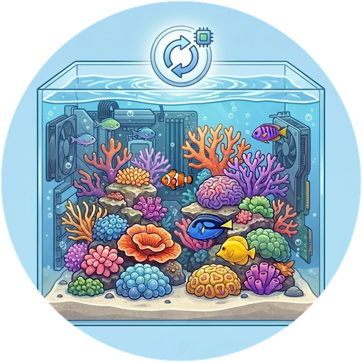
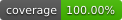
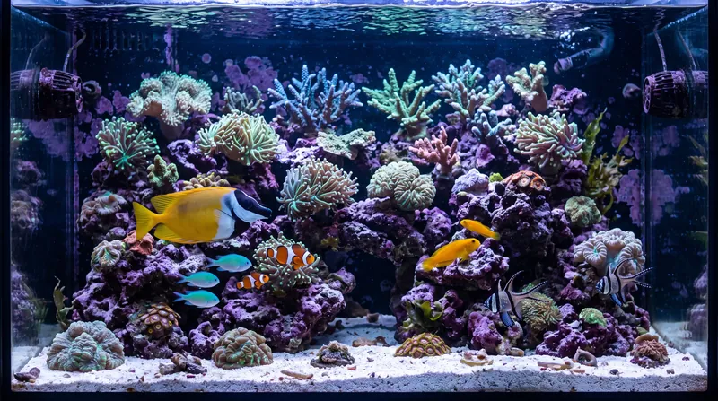

# ReefTank 🐟
> Część [**ekosystemu projektów ReefTech**](https://elwinmage.github.io/reeftank/)
<p align="center">
  
</p>

[](https://github.com/hacs/default)
[](https://developers.home-assistant.io/docs/architecture_index/#branding)
[](https://github.com/Elwinmage/ha-reeftank-component/releases)

[](https://github.com/Elwinmage/ha-reeftank-component/actions/workflows/main.yml)
[](https://github.com/Elwinmage/ha-reeftank-component/actions/workflows/hass_and_hacs.yml)
[](https://app.codecov.io/gh/Elwinmage/ha-reeftank-component)
[](https://github.com/Elwinmage/ha-reeftank-component/commits/main)
[](https://github.com/MShawon/github-clone-count-badge)
[](https://opensource.org/licenses/MIT)
[](https://github.com/Elwinmage/ha-reeftank-component)
[](https://paypal.me/Elwinmage)

# Dostępne języki: [](https://github.com/Elwinmage/ha-reeftank-component/blob/main/README.md) [](https://github.com/Elwinmage/ha-reeftank-component/blob/main/doc/fr/README.fr.md) [](https://github.com/Elwinmage/ha-reeftank-component/blob/main/doc/de/README.de.md) [](https://github.com/Elwinmage/ha-reeftank-component/blob/main/doc/es/README.es.md) [](https://github.com/Elwinmage/ha-reeftank-component/blob/main/doc/it/README.it.md) [](https://github.com/Elwinmage/ha-reeftank-component/blob/main/doc/nl/README.nl.md)  [](https://github.com/Elwinmage/ha-reeftank-component/blob/main/doc/pt/README.pt.md)

Integracja Home Assistant stojąca za **kartą akwarium** z [ha-reef-card](https://github.com/Elwinmage/ha-reef-card): żywy obraz Twojego zbiornika, oświetlony Twoimi prawdziwymi lampami, zamieszkany przez animowane ryby i koralowce, z Twoimi urządzeniami i encjami.

Przechowuje akwaria, ich zdjęcia i obsadę, rejestruje karmienia i aktualizuje katalog gatunków. Nic nie jest związane z marką: działa z Red Sea, Aqua Medic lub dowolnym innym sprzętem znanym Home Assistant.

<p align="center">
  
</p>

<!-- ecosystem:start -->

## Powiązane projekty

Projekty ReefTech uzupełniają się: integracje wprowadzają sprzęt do Home Assistant, karta go wyświetla i steruje nim, a zasilanie awaryjne utrzymuje go w ruchu podczas przerwy w zasilaniu. Każdy działa również samodzielnie.

<p align="center"><a href="https://elwinmage.github.io/reeftank/"></a></p>

<table>
  <tr>
    <th width="100px"></th>
    <th>Projekt</th>
    <th>Rola</th>
    <th>Współpracuje z</th>
  </tr>
  <tr>
    <td></td>
    <td>🐠<br /><a href="https://github.com/Elwinmage/ha-reefbeat-component"><b>ha-reefbeat-component</b></a></td>
    <td>Urządzenia Red Sea ReefBeat, sterowane lokalnie bez chmury: ReefATO+, ReefControl, ReefControl-Power, ReefDose, ReefLed, ReefMat, ReefRun i ReefWave.<br />blueprint alertów dla nietypowych trybów, kalibracji i niskiego poziomu baterii. <a href="https://my.home-assistant.io/redirect/blueprint_import/?blueprint_url=https://raw.githubusercontent.com/Elwinmage/ha-reefbeat-component/refs/heads/main/blueprints/automation/redsea_alerts.en.yaml"></a></td>
    <td>ha-reef-card</td>
  </tr>
  <tr>
    <td></td>
    <td>🌊<br /><a href="https://github.com/Elwinmage/ha-aquamedic-component"><b>ha-aquamedic-component</b></a></td>
    <td>Pompy Aqua Medic przez chmurowe API Gizwits: pompy cyrkulacyjne EcoDrift i SmartDrift, pompy DC Runner obiegowe i do odpieniacza.</td>
    <td>ha-reef-card</td>
  </tr>
  <tr>
    <td></td>
    <td>🐙<br /><a href="https://github.com/Elwinmage/ha-reef-maintenance-component"><b>ha-reef-maintenance-component</b></a></td>
    <td>Śledzenie czyszczenia i zużycia sprzętu, do którego Home Assistant nie ma dostępu: pompy cyrkulacyjne, pompy obiegowe, odpieniacze, reaktory, wszystko co obsługujesz ręcznie.</td>
    <td>ha-reef-card</td>
  </tr>
  <tr>
    <td></td>
    <td>🪸<br /><a href="https://github.com/Elwinmage/ha-reef-card"><b>ha-reef-card</b></a></td>
    <td>Interaktywny widok graficzny każdego urządzenia na pulpicie i jedyny sposób edycji zaawansowanych harmonogramów. Odczytuje trzy integracje przez wspólny kontrakt <code>reef_role</code>, bez konfiguracji po stronie karty. Rysuje też przepływy energii z reefbeatEnergyBackup. Jej karta akwarium ożywia Twój zbiornik dzięki ha-reeftank-component.</td>
    <td>wszystkie trzy integracje oraz ha-reeftank-component dla akwarium</td>
  </tr>
  <tr>
    <td></td>
    <td>🐟<br /><b>ha-reeftank-component</b><br /><i>(to repozytorium)</i></td>
    <td>Żywy obraz Twojego zbiornika na pulpicie: Twoje zdjęcie, oświetlone prawdziwymi lampami, z animowanymi rybami i koralowcami oraz Twoimi urządzeniami i encjami. Przechowuje akwaria i ich obsadę, rejestruje karmienia.</td>
    <td>ha-reef-card</td>
  </tr>
  <tr>
    <td></td>
    <td>🐡<br /><a href="https://github.com/Elwinmage/reeftank-catalog"><b>reeftank-catalog</b></a></td>
    <td>Ryby, koralowce i tekstury karty akwarium, pobierane i aktualizowane przez ha-reeftank-component.</td>
    <td>ha-reeftank-component</td>
  </tr>
  <tr>
    <td></td>
    <td>🐬<br /><a href="https://github.com/Elwinmage/ha-reef-blueprints"><b>ha-reef-blueprints</b></a></td>
    <td>Blueprinty automatyzacji wspólne dla całego ekosystemu: zaległe konserwacje znajdowane przez kontrakt <code>reef_role</code>, urządzenia, które przestały odpowiadać, okresowy test grzałek i nadzór przekaźników. Osiem języków.</td>
    <td>wszystkie trzy integracje</td>
  </tr>
  <tr>
    <td></td>
    <td>⚡<br /><a href="https://github.com/Elwinmage/reefbeatEnergyBackup"><b>reefbeatEnergyBackup</b></a></td>
    <td>Zasilanie awaryjne na wypadek przerw w zasilaniu. Pakiet 24V LiFePO₄ sterowany przez Raspberry Pi, ze stopniowym obniżaniem prędkości pomp zależnie od stanu naładowania.</td>
    <td>samodzielnie lub razem z ha-reefbeat-component i ha-reef-card</td>
  </tr>
</table>

Wszystkie są udokumentowane razem na [stronie projektu ReefTech](https://elwinmage.github.io/reeftank/).

<!-- ecosystem:end -->

## Funkcje

- **Twoje zdjęcie, żywe**: obrysuj wodę na zdjęciu zbiornika, a karta ją ożywi
- **Prawdziwe światło**: woda przyjmuje kolor i natężenie Twoich lamp (ReefLED lub dowolne `light`), nocą przyciemniona, ale czytelna
- **Ryby i koralowce** z [katalogu ReefTank](https://github.com/Elwinmage/reeftank-catalog): ławice, pływaki otwartej wody, ryby piaskowe, babki wyglądające z norki, koralowce falujące z pompami
- **Głębia**: ryby pływają za obrysowanymi skałami, a nocą odpoczywają na piasku
- **Rysowany zbiornik**: brak ładnego zdjęcia wody? Narysuj ją (woda, piasek, tekstury skał), zachowując resztę zdjęcia
- **Urządzenia i encje** umieszczane na obrazie jako miniatury lub obrysowane na nim, klikalne; strefy otwierające inny obraz (sump w szafce)
- **Karmienie**: karmniki, skróty Red Sea lub usługa rejestrują każde karmienie; ryby płyną do punktu karmienia
- **Inwentarz**: liczba ryb i koralowców jako sensory, z historią

## Instalacja

### Instalacja bezpośrednia

Kliknij tutaj, aby otworzyć repozytorium bezpośrednio w Marketplace, i kliknij „Zainstaluj”: [](https://my.home-assistant.io/redirect/hacs_repository/?owner=Elwinmage&repository=ha-reeftank-component&category=integration)

### Wyszukiwanie w Marketplace

Lub wyszukaj „ReefTank” w *Ustawienia > Marketplace*. W Home Assistant starszym niż 2026.11 te same kroki działają w HACS.

Następnie dodaj integrację (jeden wpis, nic do konfiguracji; z HACS w starszym Home Assistant najpierw uruchom ponownie): [](https://my.home-assistant.io/redirect/config_flow_start/?domain=reeftank)

Sama karta akwarium pochodzi z [ha-reef-card](https://github.com/Elwinmage/ha-reef-card), które również trzeba zainstalować.

## Pierwsze kroki

1. Dodaj **Reef Aquarium Card** do pulpitu (`custom:reef-aquarium-card`).
2. W jej edytorze utwórz akwarium (**Nowe akwarium**), następnie **Edytuj scenę**.
3. **Widoki**: prześlij zdjęcie zbiornika, obrysuj wodę, wyznacz linię piasku i skały.
4. **Urządzenia** i **Światło i przepływ**: umieść urządzenia i encje na obrazie, ustaw lampy.
5. **Obsada**: dodaj ryby i koralowce, potem zapisz.

Konfiguracja karty zawiera tylko id akwarium; resztę przechowuje integracja:

```yaml
type: custom:reef-aquarium-card
aquarium: a1b2        # set by the card editor
view: front           # optional
render: static        # optional: static, light or full
```

## Edytor sceny

Pełnoekranowe okno, otwierane z edytora karty, z siedmioma zakładkami:

| Zakładka | Co się w niej robi |
|---|---|
| **Akwarium** | Nazwa, wymiary, odpowiadające akwarium w chmurze, światło, przy którym zrobiono zdjęcia, poziom renderowania, ciemność wody w nocy |
| **Widoki** | Obrazy; dla każdej wody: obrys, linia piasku (przód i tył), skały i ich głębokość, strefy klikalne, rysowane tło i jego tekstury |
| **Urządzenia** | Twoje urządzenia i encje według pięter i obszarów, przeciągane na obraz |
| **Światło i przepływ** | Lampy oświetlające każdą wodę i ich położenie; pompy poruszające wodę |
| **Obsada** | Ryby (gatunek, liczba, rozmiar, schronienie) i koralowce (gatunek, rozmiar, kolory, położenie) |
| **Karmienie** | Encje rejestrujące karmienie i miejsce, gdzie spada pokarm |
| **Monitorowanie** | Encje pH, ORP, CO2 w pomieszczeniu i testów KH, to, co sygnalizuje kalibrację, progi alarmów oraz stan monitorowania |

## Poziomy renderowania

Każde akwarium jest wyświetlane na jednym z trzech poziomów; karta może go obniżyć, np. na wolnym tablecie ściennym:

| Poziom | Pokazuje |
|---|---|
| **Statyczny** (`static`) | obraz, urządzenia i encje |
| **Światło** (`light`) | plus kolor lamp |
| **Pełny** (`full`) | plus ryby i koralowce |

Zdjęcie pomieszczenia technicznego z urządzeniami na żywo to pełnoprawne akwarium `static`.

## Monitorowanie wody

ReefTank porównuje akwarium z jego własną niedawną historią, a nie z uniwersalnymi limitami, i zgłasza alarmy, gdy odbiega ono od normy. pH i ORP mogą pochodzić z dowolnej encji liczbowej; czujnik CO2 w pomieszczeniu jest opcjonalny. pH nie mierzy KH: te alarmy mówią, kiedy wykonać test.

| Alarm | Włącza się, gdy |
|---|---|
| **pH poniżej zwykłego poziomu** | Średnia 24 h jest o 0,1 niższa od mediany z ostatnich 14 dni. Z czujnikiem CO2 `cause` wskazuje, czy wyjaśnia to CO2 w pomieszczeniu |
| **Wahania pH większe niż zwykle** | Amplituda 24 h przekracza zwykłą o 50 % |
| **Zaburzony dobowy profil pH** | Ostatnie 4 godziny odbiegają od zwykłego kształtu doby |
| **ORP poniżej zwykłego poziomu** | ORP bez wpływu pH pozostaje o 30 mV poniżej mediany przez 12 godzin |
| **Podejrzana sonda** | Wartość zamrożona przez 12 godzin, brak wartości przez 2 godziny, powtarzające się piki, skok lub pH i ORP, które przez 2 dni nie poruszają się razem |
| **KH zmienia się zbyt szybko** | Dwa kolejne testy KH różnią się o więcej niż 0,5 dKH |

Alarmy pozostają nieznane przez pierwsze 14 dni, gdy akwarium jest poznawane; tylko podejrzana sonda działa od początku. Wszystkie progi można ustawić.

Wybierz encje raz. Ta usługa ustawia także progi:

```yaml
action: reeftank.monitoring_configure
data:
  aquarium: Reefer 425
  ph_entity: sensor.tank_ph
  orp_entity: sensor.tank_orp
  co2_entity: sensor.room_co2
  kh_entity: sensor.reefdose_head_2_last_measurement
  ph_calibration_entity: sensor.tank_ph_last_adjustment
  orp_calibration_entity: sensor.tank_orp_last_adjustment
```

Z encją testów KH (np. ostatnim pomiarem głowicy ReefDose) niedawny test odróżnia rzeczywisty spadek KH od wpływu CO2 lub problemu z sondą (`cause`), a wraz z CO2 daje szacowane KH między dwoma testami.

Z encją kalibracji (datą ostatniej regulacji sondy) kalibracja nie wymaga żadnego działania: odczyty wokół niej są odrzucane, a historia po 24 godzinach podąża za nowym poziomem. Na czas czyszczenia lub podmiany wody włącz przełącznik wstrzymania: wyłączy się sam po 6 godzinach.

## Encje

Każde akwarium jest urządzeniem z:

| Encja | Stan |
|---|---|
| `sensor.<aquarium>_fish` | Liczba ryb, według gatunków w atrybutach |
| `sensor.<aquarium>_corals` | Liczba koralowców, według gatunków w atrybutach |
| `event.<aquarium>_feeding` | Ostatnie karmienie, z rodzajem (karmnik, skrót, ręczne) i źródłem |
| `sensor.<aquarium>_feedings_today` | Karmienia od północy |
| `sensor.<aquarium>_water_monitoring` | Stan monitorowania, postęp nauki w atrybutach |
| `sensor.<aquarium>_ph_24_h_mean`, `sensor.<aquarium>_ph_swing_24_h` | Średnia i amplituda 24 h pH |
| `sensor.<aquarium>_orp_without_the_ph_effect` | ORP bez dobowego wpływu pH |
| `sensor.<aquarium>_kh_estimated` | Szacowane KH między dwoma testami (wymaga testu i CO2) |
| `binary_sensor.<aquarium>_*` | Sześć powyższych alarmów |
| `switch.<aquarium>_pause_monitoring` | Wstrzymuje analizę |
| `sensor.<aquarium>_water_volume` | Objętość wody netto (L), odczytywana przez regulację dozowania ReefDose integracji redsea |

Oraz urządzenie *ReefTank catalog*:

| Encja | Stan |
|---|---|
| `update.reeftank_catalog` | Zainstalowana i najnowsza wersja katalogu |
| `button.reeftank_catalog_check_for_updates` | Od razu sprawdza, czy jest nowa wersja |

## Usługi

| Usługa | Działanie |
|---|---|
| `reeftank.feed` | Rejestruje karmienie (karmniki nieznane Home Assistant, skrypty) |
| `reeftank.livestock_add` | Dodaje zwierzęta do inwentarza |
| `reeftank.livestock_remove` | Usuwa zwierzęta (straty, oddanie) |
| `reeftank.monitoring_configure` | Wybiera monitorowane encje i progi |
| `reeftank.monitoring_reset` | Zapomina historię, aby uczyć się od nowa (nowa sonda) |

`aquarium` to nazwa, id lub id urządzenia akwarium.

```yaml
action: reeftank.livestock_add
data:
  aquarium: Reefer 425
  species: chromis_viridis
  count: 3
```

## Katalog gatunków

Ryby, koralowce i tekstury pochodzą z [katalogu ReefTank](https://github.com/Elwinmage/reeftank-catalog), pobieranego przy pierwszym uruchomieniu (github.com musi być raz osiągalny), a potem aktualizowanego:

- nowa wersja instaluje się automatycznie; *Ustawienia → Urządzenia i usługi → ReefTank → Konfiguruj* to wyłącza;
- `button.reeftank_catalog_check_for_updates` sprawdza od razu, zamiast czekać na następne sprawdzenie (co 12 godzin);
- pobierane jest tylko to, co się zmieniło, a przerwana aktualizacja zostawia poprzedni katalog bez zmian.

Własne gatunki umieść w `<config>/reeftank/catalog/` (taki sam układ jak katalog): pojawią się w edytorze bez ponownego uruchamiania.

## Dokumentacja techniczna

Model danych, API WebSocket, potok renderowania, zachowanie ryb, format sprite'ów i aktualizacje katalogu: [dokumentacja techniczna](../../doc/en/technical.md) (po angielsku).

## Rozwój

Testy w pełni pokrywają integrację, a CI tego pilnuje. `scripts/gen_readme.py` generuje tę stronę i jej siedem tłumaczeń: zmieniaj ten skrypt, nie wygenerowane pliki.

```bash
pip install -r requirements.test.txt
pytest -q --cov=custom_components.reeftank --cov-config=.coveragerc
ruff check . && ruff format --check .
pyright --project pyrightconfig.json
python3 scripts/check_translation.py
python3 scripts/gen_readme.py
```
