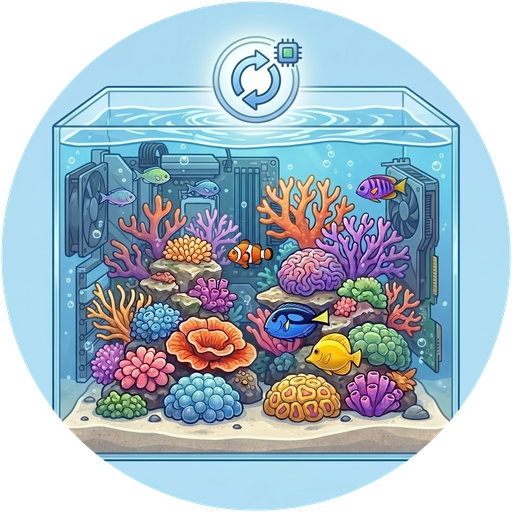

# ReefTank 🐟
> Parte do [**ecossistema de projetos ReefTech**](https://elwinmage.github.io/reeftank/)
<p align="center">
  
</p>

[](https://github.com/hacs/default)
[](https://developers.home-assistant.io/docs/architecture_index/#branding)
[](https://github.com/Elwinmage/ha-reeftank-component/releases)

[](https://github.com/Elwinmage/ha-reeftank-component/actions/workflows/main.yml)
[](https://github.com/Elwinmage/ha-reeftank-component/actions/workflows/hass_and_hacs.yml)
[](https://app.codecov.io/gh/Elwinmage/ha-reeftank-component)
[](https://github.com/Elwinmage/ha-reeftank-component/commits/main)
[](https://github.com/MShawon/github-clone-count-badge)
[](https://opensource.org/licenses/MIT)
[](https://github.com/Elwinmage/ha-reeftank-component)
[](https://paypal.me/Elwinmage)

# Idiomas disponíveis: [](https://github.com/Elwinmage/ha-reeftank-component/blob/main/README.md) [](https://github.com/Elwinmage/ha-reeftank-component/blob/main/doc/fr/README.fr.md) [](https://github.com/Elwinmage/ha-reeftank-component/blob/main/doc/de/README.de.md) [](https://github.com/Elwinmage/ha-reeftank-component/blob/main/doc/es/README.es.md) [](https://github.com/Elwinmage/ha-reeftank-component/blob/main/doc/it/README.it.md) [](https://github.com/Elwinmage/ha-reeftank-component/blob/main/doc/nl/README.nl.md) [](https://github.com/Elwinmage/ha-reeftank-component/blob/main/doc/pl/README.pl.md) 

Integração Home Assistant por trás do **cartão de aquário** do [ha-reef-card](https://github.com/Elwinmage/ha-reef-card): uma imagem viva do seu aquário, iluminada pelas suas lâmpadas reais, povoada de peixes e corais animados, e com os seus dispositivos e entidades.

Guarda os aquários, as suas imagens e a sua fauna, regista as alimentações e mantém o catálogo de espécies atualizado. Nada de específico de uma marca: funciona com Red Sea, Aqua Medic ou qualquer outro equipamento que o Home Assistant conheça.

<p align="center">
  
</p>

O cartão de aquário em ação:

[](https://www.youtube.com/watch?v=ZtYobmQZf9k)

<!-- ecosystem:start -->

## Projetos relacionados

Os projetos ReefTech encaixam-se entre si: as integrações trazem o seu equipamento para o Home Assistant, o cartão mostra-o e comanda-o, e o backup mantém-no a funcionar durante um corte. Cada um funciona também sozinho.

<p align="center"><a href="https://elwinmage.github.io/reeftank/"></a></p>

<table>
  <tr>
    <th width="100px"></th>
    <th>Projeto</th>
    <th>Função</th>
    <th>Funciona com</th>
  </tr>
  <tr>
    <td></td>
    <td>🐠<br /><a href="https://github.com/Elwinmage/ha-reefbeat-component"><b>ha-reefbeat-component</b></a></td>
    <td>Aparelhos Red Sea ReefBeat, comandados localmente sem cloud: ReefATO+, ReefControl, ReefControl-Power, ReefDose, ReefLed, ReefMat, ReefRun e ReefWave.<br />blueprint de alertas para modos anómalos, calibrações e bateria fraca. <a href="https://my.home-assistant.io/redirect/blueprint_import/?blueprint_url=https://raw.githubusercontent.com/Elwinmage/ha-reefbeat-component/refs/heads/main/blueprints/automation/redsea_alerts.en.yaml"></a></td>
    <td>ha-reef-card</td>
  </tr>
  <tr>
    <td></td>
    <td>🌊<br /><a href="https://github.com/Elwinmage/ha-aquamedic-component"><b>ha-aquamedic-component</b></a></td>
    <td>Bombas Aqua Medic através da API cloud Gizwits: bombas de circulação EcoDrift e SmartDrift, bombas DC Runner de retorno e do escumador.</td>
    <td>ha-reef-card</td>
  </tr>
  <tr>
    <td></td>
    <td>🐙<br /><a href="https://github.com/Elwinmage/ha-reef-maintenance-component"><b>ha-reef-maintenance-component</b></a></td>
    <td>Acompanhamento da limpeza e do desgaste do equipamento que o Home Assistant não consegue interrogar: bombas de circulação, bombas de retorno, escumadores, reatores, tudo o que trata à mão.</td>
    <td>ha-reef-card</td>
  </tr>
  <tr>
    <td></td>
    <td>🪸<br /><a href="https://github.com/Elwinmage/ha-reef-card"><b>ha-reef-card</b></a></td>
    <td>Vista gráfica interativa de cada aparelho no seu painel, e a única forma de editar os programas avançados. Lê as três integrações através do contrato <code>reef_role</code> comum, sem configuração do lado do cartão. Desenha também os fluxos de energia do reefbeatEnergyBackup. O seu cartão de aquário dá vida ao seu aquário com o ha-reeftank-component.</td>
    <td>as três integrações, e o ha-reeftank-component para o aquário</td>
  </tr>
  <tr>
    <td></td>
    <td>🐟<br /><b>ha-reeftank-component</b><br /><i>(este repositório)</i></td>
    <td>Uma imagem viva do seu aquário no painel: a sua foto, iluminada pelas suas lâmpadas reais, com peixes e corais animados, e os seus dispositivos e entidades. Guarda os aquários e a sua fauna, regista as alimentações.</td>
    <td>ha-reef-card</td>
  </tr>
  <tr>
    <td></td>
    <td>🐡<br /><a href="https://github.com/Elwinmage/reeftank-catalog"><b>reeftank-catalog</b></a></td>
    <td>Peixes, corais e texturas do cartão de aquário, transferidos e mantidos atualizados pelo ha-reeftank-component.</td>
    <td>ha-reeftank-component</td>
  </tr>
  <tr>
    <td></td>
    <td>🐬<br /><a href="https://github.com/Elwinmage/ha-reef-blueprints"><b>ha-reef-blueprints</b></a></td>
    <td>Blueprints de automação comuns a todo o ecossistema: manutenções em atraso encontradas pelo contrato <code>reef_role</code>, aparelhos que ficaram inacessíveis, um teste periódico dos aquecedores e uma vigilância dos relés. Oito idiomas.</td>
    <td>as três integrações</td>
  </tr>
  <tr>
    <td></td>
    <td>⚡<br /><a href="https://github.com/Elwinmage/reefbeatEnergyBackup"><b>reefbeatEnergyBackup</b></a></td>
    <td>Backup por bateria em caso de corte. Um pack 24V LiFePO₄ comandado por um Raspberry Pi, com degradação progressiva da velocidade das bombas conforme o estado de carga.</td>
    <td>sozinho, ou a par do ha-reefbeat-component e do ha-reef-card</td>
  </tr>
</table>

Estão todos documentados em conjunto na [página do projeto ReefTech](https://elwinmage.github.io/reeftank/).

<!-- ecosystem:end -->

## Funcionalidades

- **A sua foto, viva**: contorne a água numa foto do aquário e o cartão anima-a
- **Luz real**: a água ganha a cor e a intensidade das suas lâmpadas (ReefLED ou qualquer `light`), escurecida à noite mas legível
- **Peixes e corais** do [catálogo ReefTank](https://github.com/Elwinmage/reeftank-catalog): cardumes, nadadores de águas abertas, peixes de areia, gobies a espreitar da toca, corais a ondular com as bombas
- **Profundidade**: os peixes passam por trás das rochas contornadas e repousam na areia à noite
- **Aquário desenhado**: sem uma boa foto da água? Desenhe-a (água, areia, texturas de rocha) mantendo o resto da foto
- **Dispositivos e entidades** colocados na imagem como miniaturas, ou contornados nela, clicáveis; zonas que abrem outra imagem (a sump no móvel)
- **Alimentação**: alimentadores, atalhos Red Sea ou um serviço registam cada alimentação; os peixes correm para o ponto de alimentação
- **Inventário**: número de peixes e corais como sensores, com o seu histórico

## Instalação

### Instalação direta

Clique aqui para abrir o repositório diretamente no Marketplace e clique em «Instalar»: [](https://my.home-assistant.io/redirect/hacs_repository/?owner=Elwinmage&repository=ha-reeftank-component&category=integration)

### Pesquisa no Marketplace

Ou pesquise «ReefTank» em *Definições > Marketplace*. Num Home Assistant anterior a 2026.11, os mesmos passos funcionam no HACS.

Adicione depois a integração (uma entrada, nada a configurar; com o HACS num Home Assistant mais antigo, reinicie primeiro): [](https://my.home-assistant.io/redirect/config_flow_start/?domain=reeftank)

O cartão de aquário vem com o [ha-reef-card](https://github.com/Elwinmage/ha-reef-card), a instalar também.

## Primeiros passos

1. Adicione um **Reef Aquarium Card** a um painel (`custom:reef-aquarium-card`).
2. No seu editor, crie um aquário (**Novo aquário**) e depois **Editar a cena**.
3. **Vistas**: envie uma foto do aquário, contorne a água, trace a linha da areia e as rochas.
4. **Dispositivos** e **Luz e corrente**: coloque os seus dispositivos e entidades na imagem, posicione as lâmpadas.
5. **Fauna**: adicione os seus peixes e corais e guarde.

A configuração do cartão só contém o id do aquário; tudo o resto é guardado pela integração:

```yaml
type: custom:reef-aquarium-card
aquarium: a1b2        # set by the card editor
view: front           # optional
render: static        # optional: static, light or full
```

## O editor de cena

Uma janela em ecrã inteiro, aberta a partir do editor do cartão, com sete separadores:

| Separador | O que se faz lá |
|---|---|
| **Aquário** | Nome, dimensões, o aquário da nuvem correspondente, luz com que as fotos foram tiradas, nível de renderização, escuridão da água à noite |
| **Vistas** | As imagens; para cada água: contorno, linha da areia (frente e fundo), rochas e a sua profundidade, zonas clicáveis, fundo desenhado e as suas texturas |
| **Dispositivos** | Os seus dispositivos e entidades por piso e divisão, arrastados para a imagem |
| **Luz e corrente** | As lâmpadas que iluminam cada água e a sua posição; as bombas que movem a água |
| **Fauna** | Peixes (espécie, número, tamanho, abrigo) e corais (espécie, tamanho, cores, posição) |
| **Alimentação** | As entidades que registam uma alimentação, e onde cai a comida |
| **Monitorização** | As entidades de pH, ORP, CO2 da divisão e testes de KH, o que indica uma calibração, os limites dos alarmes e o estado da monitorização |

## Níveis de renderização

Cada aquário é mostrado num de três níveis; um cartão pode baixá-lo, por exemplo num tablet de parede lento:

| Nível | Mostra |
|---|---|
| **Estático** (`static`) | imagem, dispositivos e entidades |
| **Luz** (`light`) | mais a cor das lâmpadas |
| **Completo** (`full`) | mais peixes e corais |

Uma foto da sala técnica com os dispositivos em direto é um aquário `static` perfeitamente válido.

## Monitorização da água

O ReefTank compara o aquário com o seu próprio histórico recente, em vez de limites universais, e lança alarmes quando se afasta do habitual. O pH e o ORP podem vir de qualquer entidade numérica; um sensor de CO2 na divisão é opcional. O pH não mede o KH: estes alarmes dizem-lhe quando fazer um teste.

| Alarme | Dispara quando |
|---|---|
| **pH abaixo do nível habitual** | A média de 24 h fica 0,1 abaixo da mediana dos últimos 14 dias. Com um sensor de CO2, `cause` indica se o CO2 da divisão o explica |
| **Amplitude do pH maior do que o habitual** | A amplitude de 24 h excede a habitual em 50 % |
| **Perfil diário do pH alterado** | As últimas 4 horas afastam-se da forma habitual do dia |
| **ORP abaixo do nível habitual** | O ORP, sem o efeito do pH, fica 30 mV abaixo da mediana durante 12 horas |
| **Sonda suspeita** | Valor congelado durante 12 horas, nenhum valor durante 2 horas, picos repetidos, um salto, ou pH e ORP que deixam de se mover juntos durante 2 dias |
| **KH a variar demasiado depressa** | Dois testes de KH seguidos diferem mais de 0,5 dKH |

Os alarmes ficam desconhecidos nos primeiros 14 dias, enquanto o aquário é aprendido; só a sonda suspeita funciona desde o início. Todos os limiares são ajustáveis.

Escolha as entidades uma vez. Este serviço também define os limiares:

```yaml
action: reeftank.monitoring_configure
data:
  aquarium: Reefer 425
  ph_entity: sensor.tank_ph
  orp_entity: sensor.tank_orp
  co2_entity: sensor.room_co2
  kh_entity: sensor.reefdose_head_2_last_measurement
  ph_calibration_entity: sensor.tank_ph_last_adjustment
  orp_calibration_entity: sensor.tank_orp_last_adjustment
```

Com uma entidade de testes de KH (a última medida de uma cabeça ReefDose, por exemplo), um teste recente distingue uma descida real do KH de um efeito do CO2 ou de um problema de sonda (`cause`) e, com o CO2, dá um KH estimado entre dois testes.

Com uma entidade de calibração (a data do último ajuste da sonda), uma calibração não exige qualquer ação: as leituras à volta são descartadas e o histórico segue o novo nível após 24 horas. Para uma limpeza ou uma mudança de água, ligue o interruptor de pausa: desliga-se sozinho após 6 horas.

## Entidades

Cada aquário é um dispositivo com:

| Entidade | Estado |
|---|---|
| `sensor.<aquarium>_fish` | Número de peixes, por espécie nos atributos |
| `sensor.<aquarium>_corals` | Número de corais, por espécie nos atributos |
| `event.<aquarium>_feeding` | Última alimentação, com o tipo (alimentador, atalho, manual) e a fonte |
| `sensor.<aquarium>_feedings_today` | Alimentações desde a meia-noite |
| `sensor.<aquarium>_water_monitoring` | Estado da monitorização, progresso da aprendizagem nos atributos |
| `sensor.<aquarium>_ph_24_h_mean`, `sensor.<aquarium>_ph_swing_24_h` | Média e amplitude de 24 h do pH |
| `sensor.<aquarium>_orp_without_the_ph_effect` | ORP sem o efeito diário do pH |
| `sensor.<aquarium>_kh_estimated` | KH estimado entre dois testes (precisa de um teste e do CO2) |
| `binary_sensor.<aquarium>_*` | Os seis alarmes acima |
| `switch.<aquarium>_pause_monitoring` | Suspende a análise |
| `sensor.<aquarium>_water_volume` | Volume de água líquido (L), lido pela regulação da dosagem ReefDose da integração redsea |

E o dispositivo *ReefTank catalog*:

| Entidade | Estado |
|---|---|
| `update.reeftank_catalog` | Versão do catálogo instalada e mais recente |
| `button.reeftank_catalog_check_for_updates` | Verifica de imediato se há uma versão nova |

## Serviços

| Serviço | Efeito |
|---|---|
| `reeftank.feed` | Regista uma alimentação (alimentadores desconhecidos do Home Assistant, scripts) |
| `reeftank.livestock_add` | Adiciona animais ao inventário |
| `reeftank.livestock_remove` | Retira animais (perdas, cedências) |
| `reeftank.monitoring_configure` | Escolhe as entidades monitorizadas e os limiares |
| `reeftank.monitoring_reset` | Esquece o histórico para voltar a aprender (sonda nova) |

`aquarium` é o nome, o id ou o id de dispositivo do aquário.

```yaml
action: reeftank.livestock_add
data:
  aquarium: Reefer 425
  species: chromis_viridis
  count: 3
```

## Catálogo de espécies

Peixes, corais e texturas vêm do [catálogo ReefTank](https://github.com/Elwinmage/reeftank-catalog), transferido no primeiro arranque (o github.com tem de estar acessível uma vez) e depois mantido atualizado:

- uma versão nova instala-se automaticamente; *Definições → Dispositivos e serviços → ReefTank → Configurar* desativa-o;
- `button.reeftank_catalog_check_for_updates` verifica de imediato em vez de esperar pela próxima verificação (a cada 12 horas);
- só é transferido o que mudou, e uma atualização interrompida deixa o catálogo anterior no lugar.

As suas próprias espécies vão para `<config>/reeftank/catalog/` (mesma organização do catálogo): aparecem no editor sem reiniciar.

## Referência técnica

Modelo de dados, API WebSocket, cadeia de renderização, comportamento dos peixes, formato dos sprites e atualizações do catálogo: [referência técnica](../../doc/en/technical.md) (em inglês).

## Desenvolvimento

Os testes cobrem toda a integração e a CI garante-o. `scripts/gen_readme.py` regenera esta página e as suas sete traduções: é ele que se altera, não os ficheiros gerados.

```bash
pip install -r requirements.test.txt
pytest -q --cov=custom_components.reeftank --cov-config=.coveragerc
ruff check . && ruff format --check .
pyright --project pyrightconfig.json
python3 scripts/check_translation.py
python3 scripts/gen_readme.py
```
